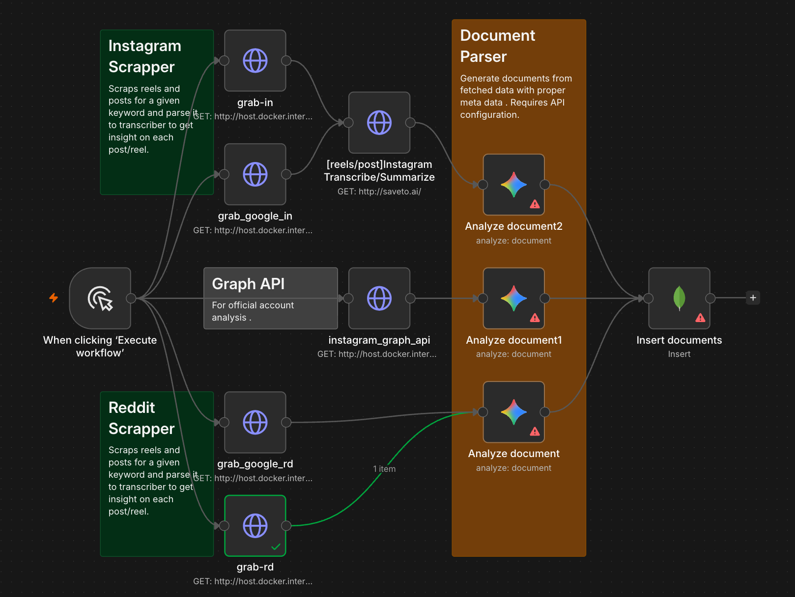

# Social Media Keyword Monitoring Pipeline

This project implements a high-performance data extraction and analysis pipeline designed to monitor social media for specific keywords, primarily for brand and product tracking.

## Pipeline Architecture


*(Attach the node graph screenshot as `node_graph.png` in the root directory to display here)*

The system follows a multi-stage workflow:
1.  **Workflow Trigger**: Initiates parallel extraction from multiple sources.
2.  **Data Extraction**: Scrapers fetch raw content (posts, reels, comments) from Instagram and Reddit.
3.  **Content Processing**: Raw media and text are transcribed and summarized using AI services.
4.  **Document Parsing & Analysis**: Data is parsed into structured documents with metadata and analyzed for deeper insights.
5.  **Persistence**: Final insights are inserted into a centralized database for reporting and monitoring.

---

## Current Modules (Implemented)

### 1. Instagram Scraper
Extends scraping capabilities to Instagram posts and reels using Selenium and Chromium.
- **Core Module**: [scraper.py](file:///Users/rohanbhoi/Desktop/instagram-scrapper/scraper.py)
- **API Service**: [grab_in_server.py](file:///Users/rohanbhoi/Desktop/instagram-scrapper/grab_in_server.py)
- **Features**: Keyword search, reel-first priority, stall detection, and session reuse via saved credentials.

### 2. Reddit Scraper
A lightweight, browserless scraper that bypasses Reddit's JS challenges to fetch high-volume data.
- **Core Module**: [reddit_scraper.py](file:///Users/rohanbhoi/Desktop/instagram-scrapper/reddit_scraper.py)
- **Features**: Keyword search, top-N posts, top-M comments, vote-ratio decomposition (upvotes/downvotes), and sort filters (hot, top, new, etc.).

---

## Installation & Setup

### Prerequisites
- **Docker & Docker Compose**: The entire environment is containerized.
- **Chrome Credentials**: Instagram requires a `credentials.json` file in the root directory:
  ```json
  {
    "username": "your_username",
    "password": "your_password"
  }
  ```

### Configuration
Environment variables are managed in [.env](file:///Users/rohanbhoi/Desktop/instagram-scrapper/.env):
- `REDDIT_PORT`: Port for the Reddit API (default: 8002).
- `REDDIT_MAX_POSTS`: Safety limit for search results.
- `REDDIT_TIMEOUT`: Request timeout in seconds.

---

## Execution Guide

### Starting the API Services
Run the services in the background using Docker Compose:
```bash
# Start Instagram API (Port 8001) and Reddit API (Port 8002)
docker compose up -d server reddit
```

### Running CLI Scrapers
You can run the scrapers directly for one-off tasks:
```bash
# Instagram CLI
docker compose run --rm scraper -k "keyword" -n 10 --type reels

# Reddit CLI
docker compose run --rm reddit python reddit_scraper.py -k "keyword" -n 5 -m 10 --sort top
```

### Running Tests
The project includes a comprehensive test suite (contract, unit, and live integration tests):
```bash
# Run all tests (Instagram & Reddit)
docker compose run --rm tests

# Run live Reddit tests (requires internet access)
docker compose run --rm -e RUN_LIVE=1 tests pytest test_reddit.py
```

---

## Additional Pipeline Components

### 1. Graph API Integration
Utilizes official Instagram/Facebook Graph APIs for authorized account analysis, providing deeper metrics like impressions and reach that are not available via public scraping.

### 2. Transcribe & Summarize
Integrates with services like `saveto.ai` to convert reel audio to text and generate concise summaries of long post bodies and comment threads.

### 3. Document Parser & Analyzer
- **Parser**: Converts heterogeneous data from various scrapers into a unified JSON document format with rich metadata.
- **Analyzer**: Performs Natural Language Processing (NLP) to detect sentiment, extract named entities (brands, competitors), and categorize content.

### 4. Database Insertion
The final stage of the pipeline responsible for indexing the analyzed documents into a database (e.g., MongoDB) for long-term storage and retrieval by visualization dashboards.
